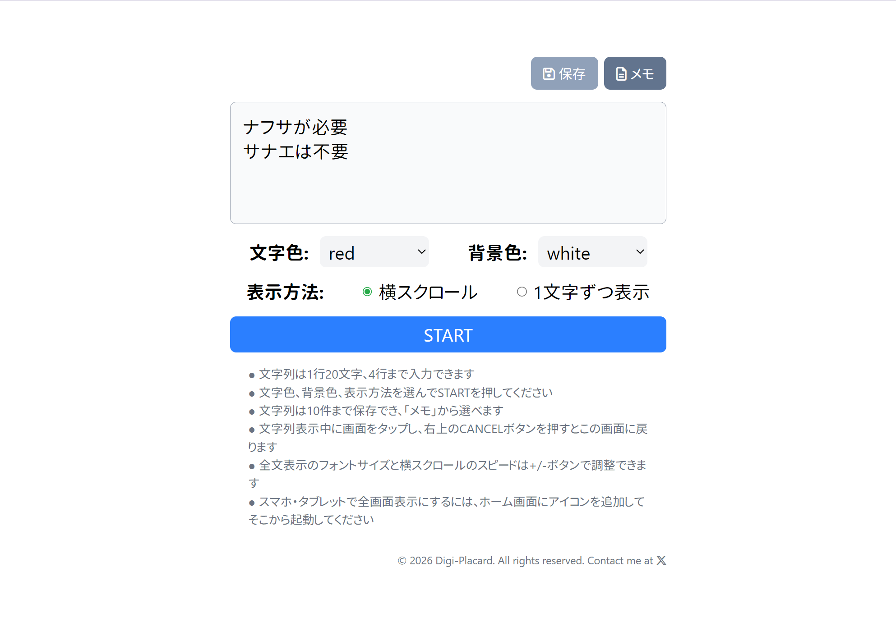

# Digi-Placard

## Live[↗️](https://digi-placard.kellybytes.dev 'Digi-Placard')

日本語の説明は英語の下にあります → [日本語](#説明)

## About

A digital placard built with React + Tailwind CSS. It shows your message one character at a time or as a horizontal scroll, then displays the full text, and repeats. **On tablets and phones, it works offline once you have opened it.**

## How to use

- Switch the language with the `EN | JA` button at the top right (English is the default)
- Enter up to 20 characters per line, up to 4 lines
- Choose the text color, background color and display mode, then press START
- In English mode, you can also choose the font (Sans-serif: Roboto / Serif: Merriweather) and weight (Default / Bold)
- You can save up to 10 messages and pick them from "Notes"
- While the message is displayed, tap the screen and press CANCEL at the top right to return to the input screen
- Use the +/- buttons to adjust the font size of the full text and the scroll speed
- To use full screen on a phone or tablet, add the app to your home screen and launch it from there

---

## 説明

React + Tailwind CSSで作ったデジタルプラカードです。入力した文字列を1文字ずつ表示／横スクロール⇔全文表示を繰り返します。**タブレットやスマホでは一度アクセスすればオフラインでも使えます。**

## 使い方

- 文字列は1行20文字、4行まで入力できます
- 文字色、背景色、表示方法を選んでSTARTを押してください
- 文字列は10件まで保存でき、「メモ」から選べます
- 文字列表示中に画面をタップし、右上のCANCELボタンを押すとこの画面に戻ります
- 全文表示のフォントサイズと横スクロールのスピードは+/-ボタンで調整できます
- スマホ・タブレットで全画面表示にするには、ホーム画面にアイコンを追加してそこから起動してください

## スクリーンショット

  
初期画面 & 表示画面

  
  

 

  
  
  

---

### 変更履歴

2026-11-16

- 英語モード追加 (UIのデフォルトを英語に変更、右上のボタンで日本語と切り替え)
- 英語モードでフォント (Sans-serif / Serif) と太さ (Default / Bold) を選択可能に

2026-04-16

- 横スクロールモード(スピード調整可)追加
- 文字列メモ機能を追加
- 入力画面、モーダルをリファクタリング

2026-03-26

- Antonフォント追加 (アルファベット用)
- フォントサイズ変更ボタン追加
- 入力可能な行を3行から4行へ変更
- 文字色に虹色を追加

2026-03-23

- 公開
